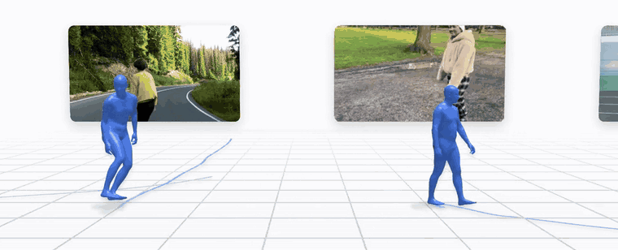
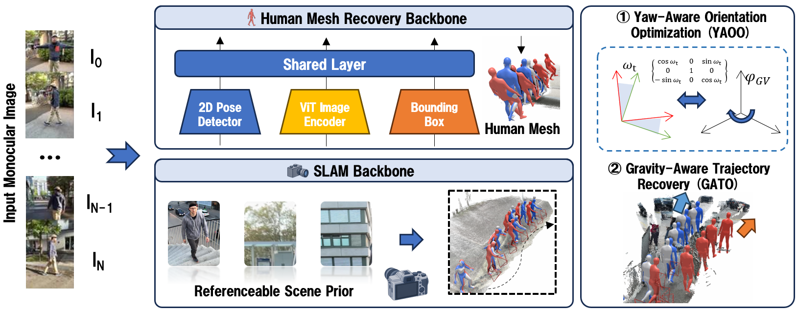

<div align="center">

# GravHMR

**Coupling SLAM and Human Mesh Recovery via Intermediate Gravity-Aligned Coordinates**

<p>
<a href="https://jhl25-pixel.github.io/gravhmr/"></a>
<a href="#citation"></a>
<a href="#citation"></a>
</p>

Hanglei Jin<sup>1,2,*,§</sup> · Chenglu Sun<sup>2,*,‡</sup> · Junchen Ge<sup>1</sup> · Yuchao Wang<sup>2</sup> ·
Siqi Chen<sup>1</sup> · Yuzhi Huang<sup>1</sup> · Jingyan Jiang<sup>3</sup> · Zhi Wang<sup>1,†</sup>


<sub><sup>1</sup> Shenzhen International Graduate School, Tsinghua University &nbsp;·&nbsp; <sup>2</sup> Tencent D-Live &nbsp;·&nbsp; <sup>3</sup> Shenzhen Technology University</sub><br>
<sub><sup>*</sup>Equal contribution &nbsp; <sup>‡</sup>Project lead &nbsp; <sup>†</sup>Corresponding author &nbsp; <sup>§</sup>Work done during internship at Tencent</sub>

</div>

<div align="center">

</div>

---

## Overview

<p align="center">

</p>

Recovering human motion in world coordinates from a moving-camera video requires accurate estimates of both body motion and camera motion; errors in either accumulate in the reconstructed trajectory. **GravHMR** is a training-free refinement that combines camera poses from SLAM with predictions from an off-the-shelf HMR model. It aligns body orientation in a shared gravity frame and refines the root trajectory in the metric SLAM world.

- **SLAM coupling.** SLAM camera rotations place camera-frame body estimates in a common world frame. The root is lifted along each 2D keypoint ray with the HMR depth, then refined so it agrees with reprojection and the body's own velocity.
- **Shared gravity axis.** heading is resolved about a gravity axis shared by camera and body, and an image-based gravity estimate stands the SLAM world upright, independently of the HMR backbone.

## Results

Global human motion on EMDB-2 and RICH. WA-MPJPE<sub>100</sub>, W-MPJPE<sub>100</sub>, FS in mm; RTE in %; Jitter in 10 m/s³. Lower is better. Our rows are in bold; see the paper for best/second-best marks.

| Method | EMDB-2 WA | EMDB-2 W | RTE | Jitter | FS | RICH WA | RICH W | RTE | Jitter | FS |
|---|--:|--:|--:|--:|--:|--:|--:|--:|--:|--:|
| SLAHMR | 326.9 | 776.1 | 10.2 | – | – | 98.1 | 186.4 | 28.9 | 34.3 | 5.1 |
| WHAM | 135.6 | 354.8 | 6.0 | 22.5 | 4.4 | 109.9 | 184.6 | 4.1 | 19.7 | 3.3 |
| TRAM | 76.4 | 222.4 | 1.4 | 18.5 | 23.4 | 103.6 | 168.4 | 2.7 | 18.7 | 12.9 |
| GVHMR | 111.0 | 276.5 | 2.0 | 16.7 | 3.5 | 78.8 | 126.3 | 2.4 | 12.8 | 3.0 |
| GVHMR + PVA-Net | 106.7 | 262.8 | 2.1 | 15.2 | 3.4 | 74.0 | 119.1 | 2.3 | 10.7 | 2.7 |
| PromptHMR-Vid | 71.0 | 216.5 | 1.3 | 16.3 | 3.5 | – | – | – | – | – |
| GENMO | 65.1 | 210.9 | 1.0 | 9.58 | 8.3 | 80.7 | 127.2 | 2.6 | 8.6 | 2.7 |
| TRAM + HTD-Refine | 71.7 | 204.9 | 1.5 | 6.6 | 7.5 | 90.2 | 145.3 | 2.5 | 4.2 | 6.5 |
| GVHMR + HTD-Refine | 69.2 | 192.4 | 1.5 | 7.2 | 5.7 | 75.2 | 123.8 | 2.3 | 3.6 | 3.3 |
| **Ours w/ masked DROID-SLAM** | 66.6 | 189.8 | 1.4 | 6.7 | 5.4 | – | – | – | – | – |
| **Ours w/ ViPE** | 57.4 | 154.0 | 1.3 | 8.5 | 5.2 | 65.5 | 109.1 | 2.1 | 3.5 | 4.3 |
| *Ours w/ static camera / GT-K* | – | – | – | – | – | *64.0* | *104.6* | *2.0* | *3.5* | *4.3* |

Ours w/ ViPE uses estimated camera poses and intrinsics. On EMDB-2, ours w/ masked DROID-SLAM uses the same camera estimates and ground-truth intrinsics as TRAM. On RICH, the static-camera variant uses a fixed camera pose and ground-truth intrinsics without running SLAM.

## Interactive results

The [project page](https://jhl25-pixel.github.io/gravhmr/) plays back every result in the browser: drag to orbit a reconstruction, scrub through time, and compare *without* and *with* GravHMR side by side against the ground truth.

## Citation

```bibtex
@article{jin2026gravhmr,
  title   = {GravHMR: Coupling SLAM and Human Mesh Recovery
             via Intermediate Gravity-Aligned Coordinates},
  author  = {Jin, Hanglei and Sun, Chenglu and Ge, Junchen and Wang, Yuchao
             and Chen, Siqi and Huang, Yuzhi and Jiang, Jingyan and Wang, Zhi},
  journal = {Under review},
  year    = {2026}
}
```

## Acknowledgements

This project builds on [GVHMR](https://github.com/zju3dv/GVHMR), PVA-Net / HTD-Refine, [ViPE](https://github.com/nv-tlabs/vipe), [GeoCalib](https://github.com/cvg/GeoCalib) and [TRAM](https://github.com/yufu-wang/tram). We thank the authors for releasing their code and models.
